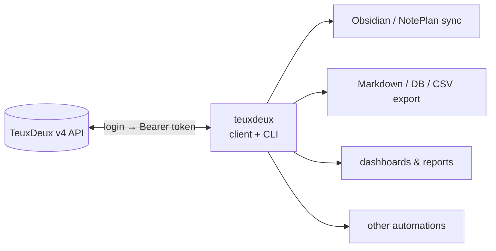

# teuxdeux

[](LICENSE)
[](pyproject.toml)

A small, typed, **unofficial** Python client + CLI for [TeuxDeux](https://teuxdeux.com).
Built on `httpx` and stdlib `dataclasses` — no heavy dependencies. Reverse-engineered
against the current **v4** API (`login → Bearer token → todos`); see [`API.md`](API.md).

> [!NOTE]
> TeuxDeux has no official API. This project is not affiliated with TeuxDeux, and the
> API it targets may change without warning.

- [Why](#why)
- [Getting started](#getting-started)
  - [Installation](#installation)
  - [Configuration](#configuration)
- [Usage](#usage)
- [Models](#models)
- [Contributing](#contributing)
- [License](#license)

## Why

TeuxDeux has no official API or automation hook (just a manual backup export). This
library opens that box — typed, read/write access to your todos so they can flow anywhere.



> [!TIP]
> It began as the engine behind an Obsidian/NotePlan daily-note sync, but that lives in a
> separate repo. **This package is just the standalone client and CLI.**

## Getting started

Requires **Python 3.11+** and a TeuxDeux account.

### Installation

Install the CLI as a standalone tool with [uv](https://docs.astral.sh/uv/) (recommended):

```sh
uv tool install git+https://github.com/namtonthat/teuxdeux
```

Or add it to a project as a library:

```sh
# with uv
uv add git+https://github.com/namtonthat/teuxdeux

# with pip
pip install git+https://github.com/namtonthat/teuxdeux
```

Or set up from source for development:

```sh
git clone https://github.com/namtonthat/teuxdeux && cd teuxdeux
./scripts/setup.sh              # venv + editable install + scaffold .env
source .venv/bin/activate
```

### Configuration

Credentials load from a `.env` in the directory you run from (or any parent), or from
real environment variables — env vars win:

```ini
TEUXDEUX_USERNAME=you@example.com
TEUXDEUX_PASSWORD=your-password
TEUXDEUX_WORKSPACE_ID=123456    # optional — find it with `teuxdeux workspaces`
```

> [!WARNING]
> `.env` is gitignored — never commit your credentials.

Check it works:

```sh
teuxdeux user    # auth check → your account JSON
```

## Usage

### CLI

```sh
teuxdeux user                 # auth check → account JSON
teuxdeux workspaces           # list workspaces → find your workspace id
teuxdeux todos --lookback 3   # last 3 days → JSON array
teuxdeux todos --since 2026-06-16 --until 2026-06-20   # explicit window (future dates OK)
teuxdeux add "buy milk" --date 2026-06-22   # create (--done to start ticked, undated if no --date)
teuxdeux set-done 12345       # mark done (--undone to reverse)
teuxdeux edit 12345 "buy oat milk"   # edit a todo's text
teuxdeux delete 12345         # delete a todo
echo '[{"op":"add","text":"x","date":"2026-06-25"},{"op":"delete","id":1}]' | teuxdeux apply
```

`--lookback N` is shorthand for `--since N-days-ago --until today`.

`apply` runs a JSON array of mutations (`add` / `set-done` / `edit` / `delete`) from stdin in
**one** session — handy for syncs that would otherwise spawn a CLI process per change. Each op
returns `{"op", "ok", …}`; a failed op is reported but does not abort the rest.

**Session caching:** login costs ~2.5s, so the Bearer token is cached (owner-only) at
`$XDG_CACHE_HOME/teuxdeux/token.json` (override with `TEUXDEUX_TOKEN_CACHE`) and reused across
invocations; an expired token is detected on a `401` and a fresh login happens automatically.

### Python

```python
import datetime as dt
import os

from teuxdeux import TeuxDeuxClient

username = os.environ["TEUXDEUX_USERNAME"]
password = os.environ["TEUXDEUX_PASSWORD"]

with TeuxDeuxClient(username, password) as client:   # logs in on enter, closes on exit
    since = dt.date.today() - dt.timedelta(days=3)
    for todo in client.todos(since=since):
        print(todo.date, todo.to_markdown())
```

## Models

Dataclasses in [`src/teuxdeux/models.py`](src/teuxdeux/models.py), built via
`from_api(dict)` (keeps modelled fields, ignores the rest):

| Model  | Key fields                                              | Helpers                                                |
| ------ | ------------------------------------------------------- | ------------------------------------------------------ |
| `Todo` | `id`, `text`, `done`, `current_date`, `position`, …     | `is_someday`, `date`, `updated_at_dt`, `to_markdown()` |
| `User` | `id`, `email`, `display_name`, `timezone`, `confirmed`  | —                                                      |

Undated ("list") todos have `current_date = null`.

## Contributing

Issues and PRs welcome. To get a dev environment:

```sh
./scripts/setup.sh          # or: uv venv && uv pip install -e ".[dev]"
source .venv/bin/activate
pytest                      # offline model tests (tests/fixtures/*.json)
pytest -m live              # live login + fetch (needs real credentials in .env)
```

## License

This repository is licensed under the [MIT License](LICENSE).

It is an unofficial client, provided as-is — not affiliated with or endorsed by TeuxDeux.
Use at your own risk.
